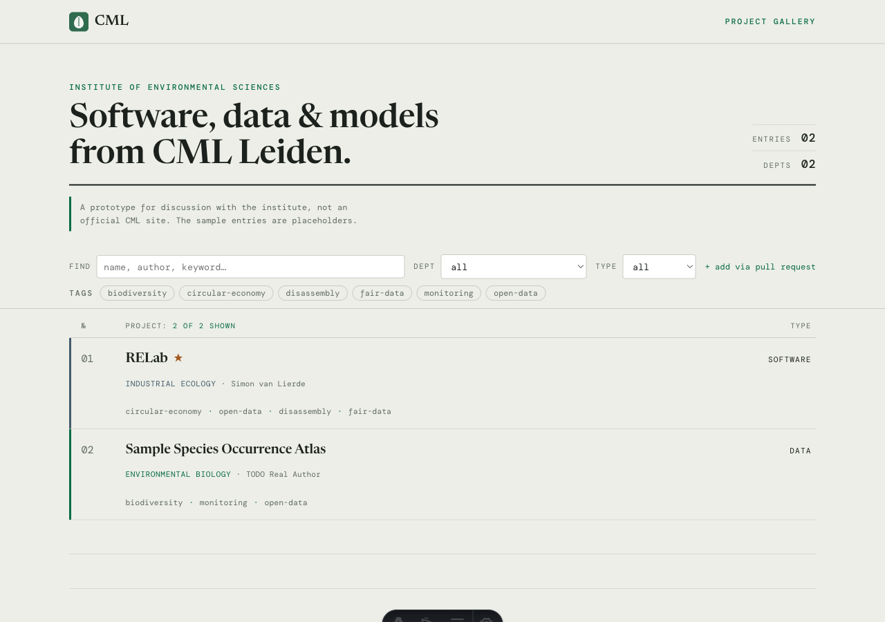

# CML Project Gallery

[](https://github.com/CMLPlatform/cml-gallery/actions/workflows/ci.yml)
[](https://github.com/CMLPlatform/cml-gallery/actions/workflows/deploy.yml)
[](https://astro.build)
[](LICENSE)

A prototype public gallery for the software, data, and models built at the
**Institute of Environmental Sciences (CML)**, Leiden University, so colleagues
can showcase their work in one place.

**Live demo: [cmlplatform.github.io/cml-gallery](https://cmlplatform.github.io/cml-gallery/)**

[](https://cmlplatform.github.io/cml-gallery/)

> **Proposal-stage prototype.** Built to demonstrate an approach for discussion with the institute. It is **not an official CML site**, and the two sample projects are clearly marked placeholders.

## The idea

Contribution should be as cheap as possible. Adding a project is **one templated
Markdown file and a pull request** — no CMS, no login, no touching the site's
code. The site stays low-maintenance, and every change goes through normal Git
review.

The file *is* the contract: each entry is validated at build time against a typed
schema ([`src/lib/entry.ts`](src/lib/entry.ts)), so a malformed entry
fails the build with a clear message instead of shipping a broken card.

## Add a project

Copy [`_TEMPLATE.md`](src/content/projects/_TEMPLATE.md), fill it in, open a PR.
Full instructions: **[CONTRIBUTING.md](CONTRIBUTING.md)**.

## Run locally

Requires **Node 24+**: the tests and the ingest script import TypeScript
directly, which Node 22.12 cannot do without a flag. CI runs Node 26.

```bash
npm install
npm run dev      # dev server with hot reload
npm run build    # production build to dist/ — also validates every entry
npm run preview  # serve the production build
npm run check    # astro check (types)
npm test         # unit tests
npm run test:a11y # axe on the built site; needs `npm run build`, `npx astro preview` and `npx playwright install chromium`
```

## Project layout

| Path | What it is |
| ---- | ---------- |
| [`src/lib/entry.ts`](src/lib/entry.ts) | The Zod schema — the ingestion contract, shared by the site and the ingest script. |
| [`src/content/projects/`](src/content/projects/) | One Markdown file per project. `_TEMPLATE.md` is the template. |
| [`src/pages/index.astro`](src/pages/index.astro) | Landing page: searchable, filterable project list. |
| [`src/pages/projects/[slug].astro`](src/pages/projects/) | Per-project detail page. |
| [`src/components/`](src/components/), [`src/scripts/filter.js`](src/scripts/filter.js) | Entry rows, filter bar, and the vanilla-JS filtering. |
| [`.github/workflows/`](.github/workflows/) | CI, deploy to GitHub Pages, optional ingestion. |

### Design notes

- **Astro static site**, typed content collections, **zero client framework**.
  Filtering and search are plain DOM over the server-rendered list, so the
  gallery still works with JavaScript disabled (the filter bar is hidden then).
- **Accessible by default:** semantic HTML, labelled and keyboard-navigable
  filters, visible focus, WCAG-AA contrast, and colourblind-safe (Okabe-Ito)
  category colours that are always paired with text. CI runs axe (WCAG 2.2 AA)
  on every built page in light and dark mode.
- **Fonts are self-hosted** (`@fontsource`), so the site makes no third-party
  requests — relevant for an EU institute.
- Images are lazy-loaded.

## Deploy

[`.github/workflows/deploy.yml`](.github/workflows/deploy.yml) builds and
publishes to **GitHub Pages** on every push to `main`.

Before the first deploy:

1. Set the URL in [`astro.config.mjs`](astro.config.mjs). Project site
   (`https://<org>.github.io/<repo>`): set `site` and `base: '/<repo>/'`. User/org
   site or custom domain: set `base: '/'`.
2. In repository settings, set **Pages → Build and deployment → Source** to
   **GitHub Actions**.

For Cloudflare Pages instead: build command `npm run build`, output directory
`dist/`. No Cloudflare config is included here.

## Optional: automated ingestion

Hand-authored entries are the primary path. As an **optional** supplement, a
separate script can surface repositories automatically:

```bash
npm run ingest                                   # write new drafts
node scripts/fetch-github-projects.mjs --dry-run # preview without writing
```

[`scripts/fetch-github-projects.mjs`](scripts/fetch-github-projects.mjs) fetches
public repositories in the `CMLPlatform` org that carry the **`cml-showcase`**
topic and writes one draft entry per repo, derived from its description,
homepage, topics, and README excerpt.

Safeguards:

- Every generated entry gets **`draft: true`**, so it is **excluded from the
  built site** until a maintainer reviews it, fills in the TODO fields
  (`department`, `authors`), and removes the flag. Each draft is checked
  against the site's schema before it is written, and the schema refuses an
  entry that still has a `TODO` author, name, summary or tag once `draft: true`
  is gone.
- **Nothing is drafted twice or overwritten:** a repo is skipped when an
  existing entry already links to it in `links.repo` (whatever the file is
  called), when `<repo-name>.md` or `.mdx` already exists, or when it is listed
  in [`scripts/ingest-skip.txt`](scripts/ingest-skip.txt). Add a repo there to
  decline it for good; closing its draft PR alone does not stop the next run.

[`.github/workflows/ingest.yml`](.github/workflows/ingest.yml) runs this weekly
(and on demand), runs `astro check` on the drafts, and opens a pull request
with any new ones, so review happens through the same PR flow as everything
else. That PR is opened with the workflow's own token, so CI does not run on it;
the check inside the ingest job stands in for it. Delete that workflow for
hand-curation only.

## Context

This prototype is meant to start a conversation about shared research
infrastructure at CML. It overlaps with an AI4IE web-apps showcase, which could
later reuse the same template-and-PR ingestion approach.

## License

[MIT](LICENSE).
